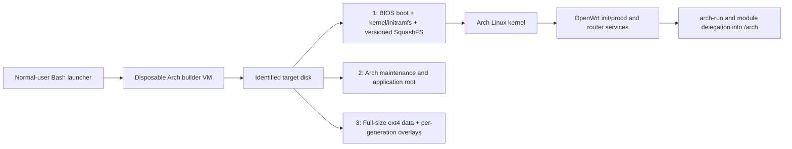

# Architecture and build recipes



The installer allocates all remaining sectors to partition 3 and formats ext4 at
its final size. Boot performs no partition-table writes or filesystem resizing.
OpenWrt still needs its preinit helper to select and mount the persistent
overlay.

The custom mkinitcpio hook mounts the selected immutable SquashFS and prepares
backing mounts. OpenWrt preinit and patched `fstools` own the final overlay.
Each exact patched-image hash gets its own upper/work directories and
initialization state. Shared data is outside those directories. No boot failure
silently reformats data or substitutes a temporary root.

| Source | Responsibility |
| --- | --- |
| `builder/bootstrap.sh` | Fresh Arch builder, compiler/tool dependencies, reusable guest dispatcher |
| `builder/job.sh`, `builder/install.py` | Verified input job, target identity, partition/filesystem installation, package ownership, provenance |
| `recipes/openwrt/build.sh` | Pinned SDK/feed, patched upstream packages, musl wrapper, native APK tool built from source |
| `recipes/openwrt/prepare_core.py`, `patches/` | Owner-specific ubox, fstools, procd and base-files changes |
| `recipes/arch/PKGBUILD`, `recipes/arch/mkinitcpio/` | Packaged Arch integration, initramfs and transaction hooks |
| `src/runtime.py` | Media identity, fixed partition/filesystem validation, generations, backing mounts and network roles |
| `src/arch-run.c` | Verified chroot entry from musl OpenWrt to glibc Arch; root only, never setuid |
| `src/kmod-entry.c`, `src/module_bridge.py` | Early/direct module loading, aliases, options, blacklists and errors |
| `src/shutdown-final.c` | Static PID 1 handoff from RAM after service termination; releases replaced executable mappings before clean readonly remounts |
| `src/publish_boot.py`, `src/update.py`, `src/guard-update` | Coherent kernel/initramfs publication and guarded full Arch updates |
| `src/generations.py` | Reviewed OpenWrt generation preparation, selection and rollback |
| `src/apps.py`, `src/frarchenstein-apps.init` | Optional generic application supervision, mapped identities, cgroup cleanup and update lifecycle |
| `tools/devices.py` | Host usage/identity checks, held disk descriptors, metadata-only filesystem checks |
| `tools/start.py`, `builder/lab-client.sh` | Router/client laboratory topology and localhost management |

## Maintenance boundary

From the root OpenWrt console, enter the prepared Arch userspace using:

```sh
/usr/libexec/frarchenstein/arch-run /bin/bash
```

This is an actual chroot sharing the running kernel, network and prepared API
filesystems. It is not a security container. Application services use the same
root entry before dropping to their explicitly mapped UID/GID. The generic
installation has no registered private applications.

OpenWrt module entrypoints support `modprobe [-a] [-q] [-v] NAME [OPTIONS]`,
`insmod NAME [OPTIONS]`, `rmmod NAME`, `lsmod`, and `modinfo [-F FIELD] NAME`.
Unsupported options are refused. Names and aliases resolve against the running
Arch kernel and the reviewed module policy.

Use `router-arch-update --help` and `router-openwrt-update --help` inside Arch
for the reviewed maintenance entrypoints. Full Arch transactions stage and
validate kernel/initramfs publication; failure requires explicit repair. Running
modules remain available until reboot. There are no Arch/kernel rollback slots.
New kernel contracts require an updated module-policy review.

OpenWrt core changes are rebuilt under their true owners and installed from a
signed local repository with dependency constraints. APK cannot replace them
with incompatible stock owners. The architecture does not load OpenWrt `.ko`
files into the Arch kernel. `button-hotplug` is excluded. New OpenWrt versions
require refreshed source pins, patches and acceptance tests; a stock firmware
upgrade is not safe for this layout. Native sysupgrade/reset entrypoints refuse
that operation.

OpenWrt rollback selects a SquashFS together with its corresponding overlay.
Arch applications and shared data are not rolled back. Backups must cover all
three partitions and retained generations. Generic cross-capacity backup
restoration is not implemented by these installation scripts. Private backup
import remains a separate task after the clean distribution has passed
acceptance.

## Trust and reproducibility

`configs/versions.json` pins input URLs, digests, signing fingerprints, the Arch
archive date, OpenWrt SDK/feed commit and source archives. Download verification
uses an isolated GPG keyring. Pacman and APK verification remain enabled. The
SDK recipe verifies upstream owner Makefile hashes before patching, so upstream
drift fails visibly.

Each build generates separate Arch/OpenWrt package signing identities. Public
keys are installed in the target. Private signing material stays in the
disposable builder and the job's ignored `exports/private/` directory; it is
never a repository asset. Preserve it privately for future signed package work.

During shutdown, procd terminates services and executes a static helper from
tmpfs. This releases executable mappings left by package replacements, then
remounts the overlay and all persistent filesystems read-only before poweroff. A
failed remount blocks poweroff. No forced or lazy unmount substitutes for a
clean shutdown.

The reusable builder boots its exported kernel/initramfs with its filesystem
UUID. The final router boots through BIOS/EXTLINUX from the installed target. SD
storage is emulated as SATA, avoiding a runtime dependency on virtio block
storage. Virtio block remains a builder/client implementation detail.
